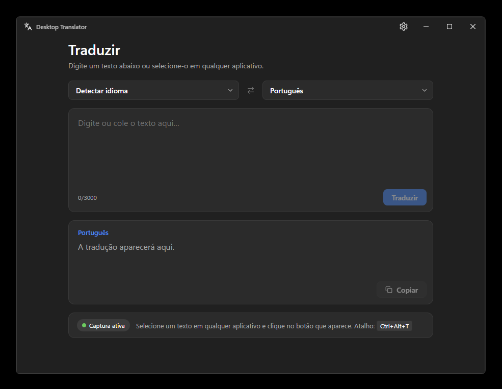
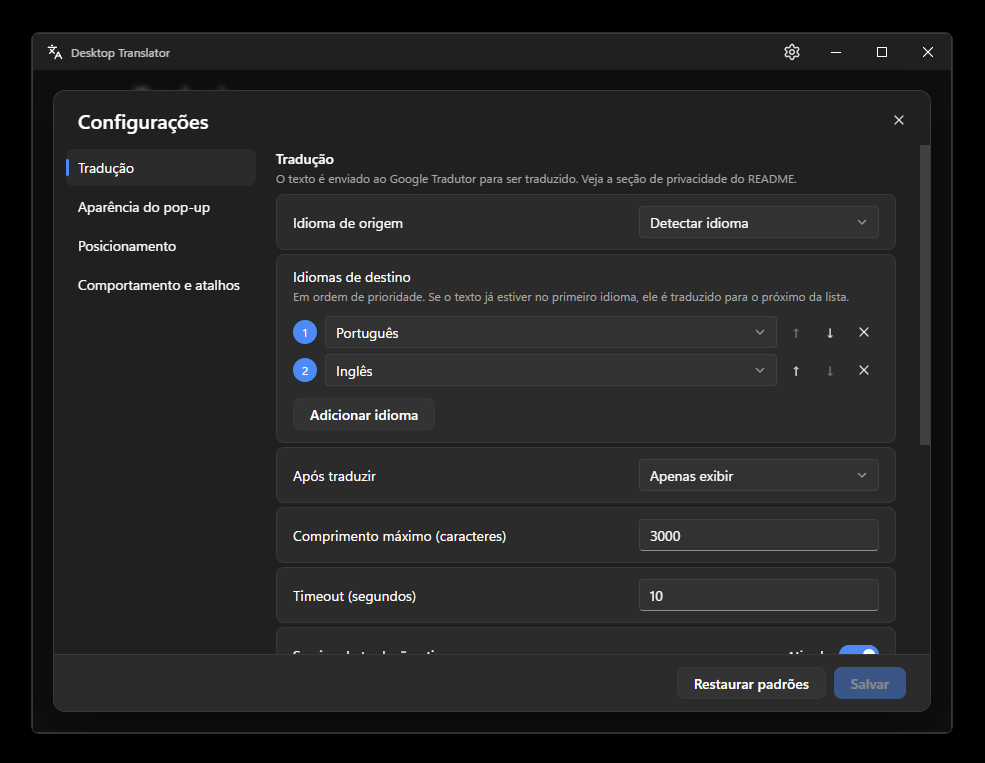
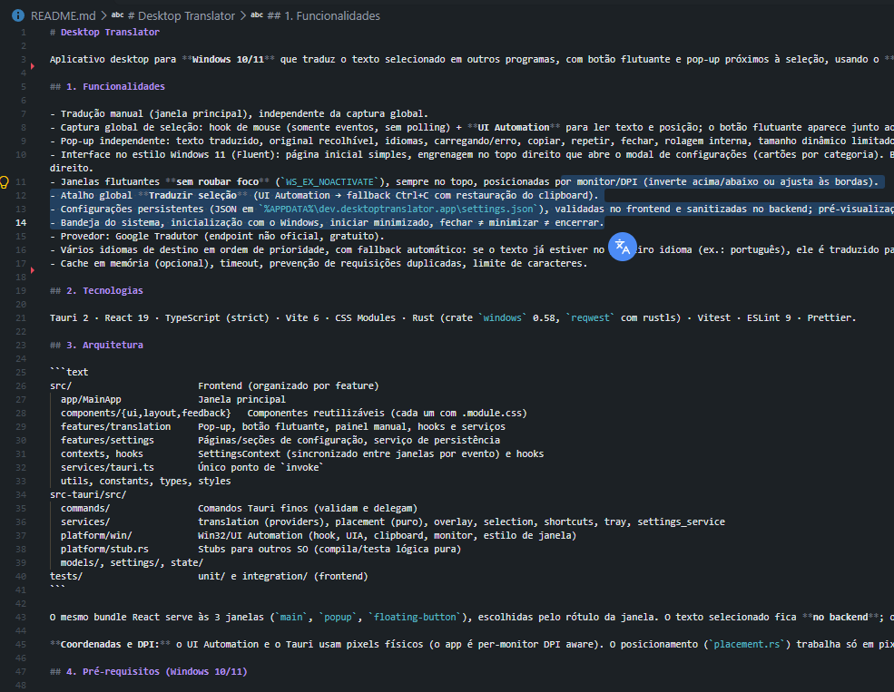
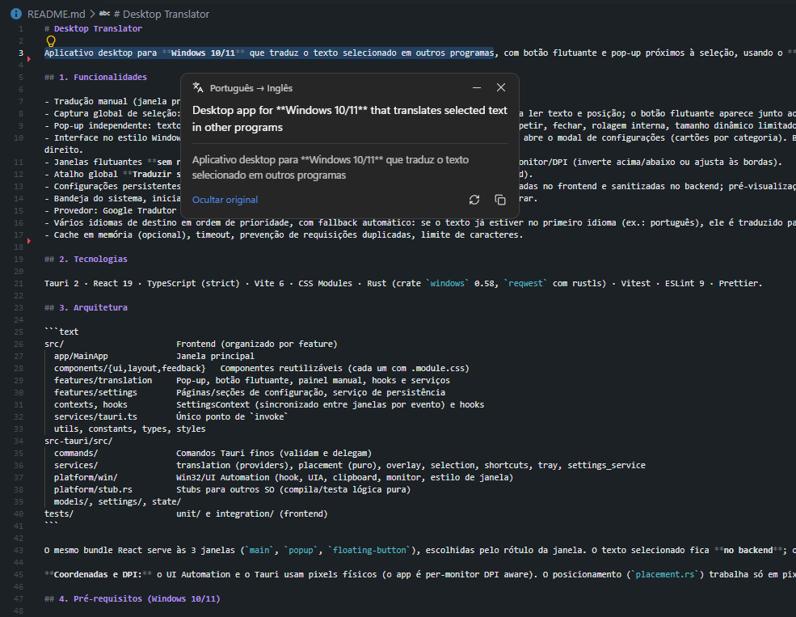

# Desktop Translator

Aplicativo desktop para **Windows 10/11** que traduz o texto selecionado em outros programas, com botão flutuante e pop-up próximos à seleção, usando o **Google Tradutor**. Construído com Tauri 2, React, TypeScript e Rust.

## Funcionalidades

- Tradução manual (janela principal), independente da captura global.
- Captura global de seleção: hook de mouse (somente eventos, sem polling) + **UI Automation** para ler texto e posição; o botão flutuante aparece junto ao fim da seleção.
- Pop-up independente: texto traduzido, original recolhível, idiomas, carregando/erro, copiar, repetir, fechar, rolagem interna, tamanho dinâmico limitado pelas configurações.
- Interface no estilo Windows 11 (Fluent): página inicial simples, engrenagem no topo direito que abre o modal de configurações (cartões por categoria). Barra de título própria com minimizar/maximizar/fechar. No pop-up, o cabeçalho é transparente (título à esquerda; recolher e fechar à direita) e copiar/repetir ficam no canto inferior direito.
- Janelas flutuantes **sem roubar foco** (`WS_EX_NOACTIVATE`), sempre no topo, posicionadas por monitor/DPI (inverte acima/abaixo ou ajusta às bordas).
- Atalho global **Traduzir seleção** (UI Automation → fallback Ctrl+C com restauração do clipboard).
- Configurações persistentes (JSON em `%APPDATA%\dev.desktoptranslator.app\settings.json`), validadas no frontend e sanitizadas no backend; pré-visualização em tempo real; restaurar padrões.
- Bandeja do sistema, inicialização com o Windows, iniciar minimizado, fechar ≠ minimizar ≠ encerrar.
- Provedor: Google Tradutor (endpoint não oficial, gratuito).
- Vários idiomas de destino em ordem de prioridade, com fallback automático: se o texto já estiver no primeiro idioma (ex.: português), ele é traduzido para o próximo da lista (ex.: inglês).
- Cache em memória (opcional), timeout, prevenção de requisições duplicadas, limite de caracteres.

## Imagens:

<details>
  <summary><b>Clique para ver todas as imagens</b></summary>
  <br/>
   <p align="center">
      
      
      
      
   </p>
</details>

## Tecnologias

Tauri 2 · React 19 · TypeScript (strict) · Vite 6 · CSS Modules · Rust (crate `windows` 0.58, `reqwest` com rustls) · Vitest · ESLint 9 · Prettier.

## Arquitetura

```text
src/                       Frontend (organizado por feature)
  app/MainApp              Janela principal
  components/{ui,layout,feedback}   Componentes reutilizáveis (cada um com .module.css)
  features/translation     Pop-up, botão flutuante, painel manual, hooks e serviços
  features/settings        Páginas/seções de configuração, serviço de persistência
  contexts, hooks          SettingsContext (sincronizado entre janelas por evento) e hooks
  services/tauri.ts        Único ponto de `invoke`
  utils, constants, types, styles
src-tauri/src/
  commands/                Comandos Tauri finos (validam e delegam)
  services/                translation (providers), placement (puro), overlay, selection, shortcuts, tray, settings_service
  platform/win/            Win32/UI Automation (hook, UIA, clipboard, monitor, estilo de janela)
  platform/stub.rs         Stubs para outros SO (compila/testa lógica pura)
  models/, settings/, state/
tests/                     unit/ e integration/ (frontend)
```

O mesmo bundle React serve às 3 janelas (`main`, `popup`, `floating-button`), escolhidas pelo rótulo da janela. O texto selecionado fica **no backend**; o botão só dispara `open_translation_popup`.

**Coordenadas e DPI:** o UI Automation e o Tauri usam pixels físicos (o app é per-monitor DPI aware). O posicionamento (`placement.rs`) trabalha só em pixels físicos; tamanhos lógicos do CSS são multiplicados pela escala do monitor (`GetDpiForMonitor`) e a área útil vem de `GetMonitorInfoW` (exclui a barra de tarefas).

## Pré-requisitos (Windows 10/11)

1. **Node.js 20+** (LTS) com npm: <https://nodejs.org>.
2. **Rust estável** via rustup (<https://rustup.rs>), toolchain `stable-x86_64-pc-windows-msvc`.
3. **Microsoft C++ Build Tools** (workload "Desktop development with C++") e Windows SDK.
4. **WebView2 Runtime** (já presente no Windows 11 e no Windows 10 atualizado).
5. Para gerar `.msi`: WiX Toolset v3 (o Tauri baixa automaticamente na primeira vez). O instalador NSIS (`.exe`) não precisa dele.

Guia oficial: <https://v2.tauri.app/start/prerequisites/>.

## Instalação e execução

```powershell
npm install            # gera package-lock.json (versione-o)
npm run tauri:dev      # desenvolvimento (Cargo.lock é gerado na primeira compilação)
```

## Build de produção

```powershell
npm run tauri:build
```

## Configuração do tradutor

- **Provedor:** Google Tradutor, via o endpoint público `translate.googleapis.com/translate_a/single` (`client=gtx`), o mesmo usado por extensões. **Não é uma API documentada**: pode mudar, limitar ou bloquear requisições sem aviso, e não há cota ou SLA garantidos. Adequado para uso pessoal. Não há chaves nem credenciais a configurar.
- **Idiomas de destino (Configurações → Tradução):** lista de 1 a 5 idiomas em ordem de prioridade. O texto é traduzido para o primeiro idioma; se o idioma detectado já for esse (ex.: o texto já está em português), usa-se o próximo da lista. Se a origem for fixa (não "Detectar idioma"), destinos iguais à origem são ignorados. Se o texto estiver em todos os idiomas da lista, devolve-se a tradução para o primeiro. Na tela inicial, escolher um destino o torna o principal.
- A arquitetura mantém um contrato de provedor (`TranslationProvider`) para adicionar outros no futuro.

## Privacidade

- O texto traduzido (selecionado ou digitado) é **enviado ao Google** (HTTPS). Não selecione conteúdo que não possa ser enviado a terceiros.
- Nada é gravado em disco além das configurações. O cache é só em memória. Textos não são registrados em logs. Sem telemetria.
- A captura lê a seleção apenas após um gesto de mouse (arrastar/duplo clique) ou o atalho; campos de senha são ignorados; o clipboard é restaurado no fallback.

## Personalização, atalhos e inicialização

- **Aparência/posição:** Configurações → Aparência e Posicionamento (tema, tamanhos, cores hex, fonte, raio, opacidade, lado preferido, deslocamentos, distâncias, margem, comportamento sem espaço). Cores vazias seguem o tema. Aplicado imediatamente via variáveis CSS.
- **Atalhos** (padrões): `Ctrl+Alt+T` traduzir seleção · `Ctrl+Alt+Shift+T` ativar/desativar captura · `Ctrl+Alt+M` abrir janela. Formato `Ctrl|Alt|Shift|Super + tecla`. Atalhos em uso por outro programa geram aviso ao salvar.
- **Iniciar com o Windows:** usa `tauri-plugin-autostart` (entrada no registro do usuário). **Iniciar minimizado** abre apenas na bandeja.

## Comandos

```powershell
npm run typecheck      # tsc --noEmit
npm run lint           # ESLint (impõe: componentes/hooks com function, interfaces com prefixo I, sem React.FC/classes)
npm run lint:rust      # cargo clippy -D warnings
npm run format         # Prettier + cargo fmt   (format:check apenas verifica)
npm test               # Vitest (frontend)
npm run test:rust      # cargo test (placement, settings, provedores, cache)
npm run test:all
```
